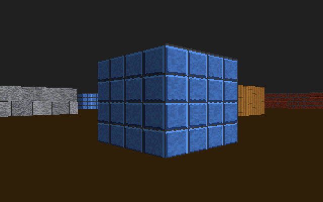

# bootcaster

A Wolfenstein-style raycaster that boots straight off a disk image. There's no
OS and no libraries, just a 512-byte boot sector, about 2 KB more of 16-bit x86
assembly, the BIOS and the VGA card.



The whole image is 3 KB in size. Everything you see gets made at boot including the sine
table (using the x87), the 256 color palette, and the four 64x64 wall textures
(from a 16-bit LFSR).

## Build and run

You need [NASM](https://nasm.us), and QEMU if you want to run it.

```
make          # builds bootcaster.img
make run      # boots it in qemu-system-i386
```

| Key | |
|---|---|
| W / S, Up / Down | walk |
| A / D | strafe |
| Left / Right | turn |
| Esc | reboot (it pulses the reset line through the keyboard controller) |

`make -B STATS=1` builds a version that prints the frame rate and how many DDA
steps each frame took to port 0xE9, once a second. You can see that in QEMU
with `-debugcon stdio`:

```
qemu-system-i386 -drive format=raw,file=bootcaster.img -debugcon stdio
```

## Real hardware

I've only run it in QEMU 10.2 so far. In theory you could `dd` the image to a
USB stick and boot it on any PC with legacy BIOS (or CSM) boot, though I haven't
tested that. It needs a 386 or newer with an FPU, VGA, and a BIOS with the
INT 13h extensions, which anything that boots from USB should have.

## How it works

| File | |
|---|---|
| `src/boot.asm` | The boot sector. Sets up segments and a stack, loads the rest of the image with INT 13h AH=42h and jumps to it. |
| `src/main.asm` | Setup and the main frame loop. |
| `src/video.asm` | Mode 13h, plus a back buffer at 0x20000 that gets copied to 0xA0000 during vertical retrace. |
| `src/math.asm` | 16.16 fixed point and a 1024 entry sine table built with `fsin`. |
| `src/raycast.asm` | One ray per column, stepped through the map with DDA. Distance is measured along the view direction so the walls don't bend. |
| `src/palette.asm` | Four 32-shade ramps and a half-brightness copy of them, so bit 7 means "in shadow". |
| `src/textures.asm` | Brick, stone, tile and wood, made one texel at a time. |
| `src/input.asm` | An IRQ 1 handler that keeps track of which keys are held, plus movement with wall sliding. |
| `src/timer.asm` | The 8254 at 1 kHz so movement speed doesn't depend on frame rate. |

Where stuff lives in memory (physical addresses):

| | |
|---|---|
| 0x01000 | sine table (4 KB) |
| 0x02000 | palette scratch |
| 0x07C00 | boot sector, stack below it |
| 0x07E00 | everything else |
| 0x20000 | back buffer (64,000 bytes) |
| 0x30000 | textures (16 KB) |
| 0xA0000 | VGA framebuffer |

I wrote about how it all came together on
[my site](https://www.joelmr.com/blog/raycaster-on-bare-metal/), including some of my troubleshooting. If you are curious, check it out.

## License

MIT
